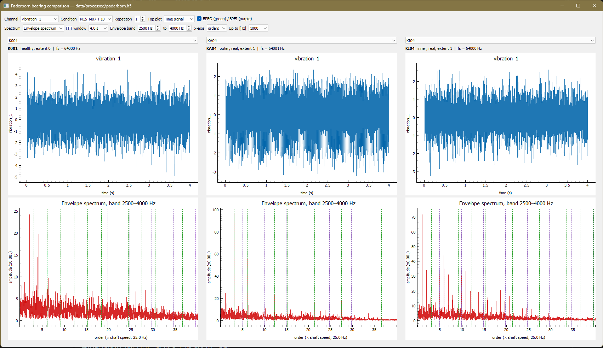

# Paderborn bearing fault analysis

Signal processing and visualisation of rolling-bearing faults on the
[Paderborn University bearing dataset](https://mb.uni-paderborn.de/kat/forschung/bearing-datacenter/):
vibration and motor-current measurements from healthy bearings and bearings
with outer-ring, inner-ring and combined damage, both artificial and from
accelerated lifetime tests.

The project converts ~2 500 MATLAB measurement files into one structured HDF5
file, and provides a PyQtGraph viewer that compares three bearings side by side
in the time domain and in several spectral representations.



## What the data shows so far

At 1500 rpm, a bearing with real outer-ring damage (KA04) shows a comb of
peaks at the ball-pass frequency of the outer ring (BPFO ≈ 76 Hz) and its
harmonics, already in the raw vibration spectrum. A healthy bearing (K001)
under the same conditions shows a flat noise floor. The pattern is stable
across all 20 repetitions of a measurement and moves with shaft speed.

Inner-ring damage is less clear in the raw spectrum. The peaks do not sit
exactly on the BPFI harmonics, which is consistent with modulation by shaft
rotation. Envelope analysis and order spectra are the tools for separating
these signatures, and are included in the viewer.

## Dataset

| | |
|---|---|
| Bearings | 32 (6 healthy, 12 outer ring, 11 inner ring, 3 combined) |
| Measurements | 80 per bearing: 4 operating conditions × 20 repetitions |
| Duration | ~4 s per measurement |
| Channels | vibration, 2 motor phase currents (64 kHz); force, torque, speed (4 kHz); temperature (1 Hz) |

**Operating conditions**, encoded in the file name (e.g. `N15_M07_F10_KA04_1`):

| Code | Speed | Load torque | Radial force |
|---|---|---|---|
| `N15_M07_F10` | 1500 rpm | 0.7 Nm | 1000 N |
| `N09_M07_F10` | 900 rpm | 0.7 Nm | 1000 N |
| `N15_M01_F10` | 1500 rpm | 0.1 Nm | 1000 N |
| `N15_M07_F04` | 1500 rpm | 0.7 Nm | 400 N |

**Labels** per bearing (damage class, artificial or real, damage method,
severity) are in [`metadata/bearings.csv`](metadata/bearings.csv) and were
checked against the bearing data sheets shipped with the dataset.

**Known issue:** `N15_M01_F10_KA08_2.mat` cannot be read
(`TypeError: Expecting matrix here`) and is excluded, so the HDF5 file holds
2 559 of 2 560 measurements. The skipped file is recorded in the conversion log.

## HDF5 layout

```
paderborn.h5
└── <bearing>/                 attrs: damage_class, damage_origin, damage_method, extent
    └── <measurement>/         attrs: speed_rpm, torque_nm, radial_force_n, repetition, ...
        └── <channel>          float32, gzip-compressed, attr: fs
```

Signals are stored at their native sampling rate, with `fs` computed from each
file's own time axis. Windowing, normalisation and feature extraction happen
later, so the raw file never has to be rebuilt. Compression brings ~22 GB of
`.mat` files down to 5.6 GB.

## Viewer

```bash
python src/paderborn/viewer.py
```

All three columns share channel, operating condition and repetition, so any
difference between them comes from the bearing. Available views:

| View | What it shows |
|---|---|
| **FFT** | Amplitude spectrum of a Hann-windowed segment. Window length sets the resolution (Δf = 1/T). |
| **Welch PSD (dB)** | Averaged spectrum on a log scale; makes weak motor-current signatures visible. |
| **Envelope spectrum** | Band-pass around a structural resonance → Hilbert envelope → FFT. Recovers the fault repetition rate that the raw spectrum hides. |
| **Orders** | Frequency divided by shaft speed, so fault frequencies stay put across speeds (BPFO ≈ 3.05, BPFI ≈ 4.95 for the 6203 bearing). |
| **Spectrogram** | Frequency over time; impacts appear as repeating stripes in the resonance band. |

Fault-frequency lines (BPFO green, BPFI purple) are drawn from each
measurement's own shaft speed. The factors come from nominal 6203 geometry and
are approximate.

## Setup and usage

```bash
python -m venv .venv                     # Python 3.12
.\.venv\Scripts\Activate.ps1             # Windows (source .venv/bin/activate on macOS/Linux)
pip install torch --index-url https://download.pytorch.org/whl/cuXXX   # see pytorch.org
pip install -r requirements.txt
pip install -e .
```

1. Download the bearing archives (`K001.rar`, `KA01.rar`, ...) from the
   [Paderborn Bearing DataCenter](https://mb.uni-paderborn.de/kat/forschung/bearing-datacenter/)
   and extract them to `data/raw/<bearing>/`.
2. Convert to HDF5 (~4.5 min for all 2 560 files):
   ```bash
   python src/paderborn/to_hdf5.py
   ```
3. Open the viewer:
   ```bash
   python src/paderborn/viewer.py
   ```

Run the tests with `pytest`. The spectral tools are tested on a synthetic
signal (impacts at 76 Hz ringing a 3.2 kHz resonance), where the envelope
spectrum must recover 76 Hz and its harmonics.

## Project structure

```
src/paderborn/
├── loader.py      read one .mat file → signals with sampling rates; parse file names
├── to_hdf5.py     convert all measurements to one HDF5 file
├── spectra.py     FFT, Welch PSD, envelope spectrum, spectrogram (no GUI code)
└── viewer.py      PyQt5 / PyQtGraph comparison viewer
metadata/bearings.csv   bearing labels
notebooks/              exploration
tests/                  unit tests
```

The signal processing lives in `spectra.py`, separate from the GUI, so the same
code is used by the viewer, the notebooks and the planned feature pipeline.

## Next steps

- **Feature extraction in parallel** (`multiprocessing`) over windowed signals:
  envelope-spectrum amplitudes at fault orders, RMS, kurtosis.
- **Fault classification with an honest evaluation:** train/validation/test
  split *per bearing* (not per measurement, which leaks), class weights for the
  imbalance, balanced accuracy and confusion matrices.
- **Harder generalisation tests:** train on artificial damage and test on real
  damage; train at 1500 rpm and test at 900 rpm.
- **Combined damage as an out-of-distribution test:** a multi-label model
  (outer yes/no, inner yes/no) trained on single faults, checked for whether
  both outputs fire on the combined-damage bearings.
- **Sensor comparison:** vibration only vs. motor current only vs. both.

## References

- C. Lessmeier, J. K. Kimotho, D. Zimmer, W. Sextro (2016). *Condition Monitoring
  of Bearing Damage in Electromechanical Drive Systems by Using Motor Current
  Signals of Electric Motors: A Benchmark Data Set for Data-Driven
  Classification.* European Conference of the PHM Society.
- R. B. Randall, J. Antoni (2011). *Rolling element bearing diagnostics — A
  tutorial.* Mechanical Systems and Signal Processing 25(2).
- T. Decker, M. Lebacher, V. Tresp. *Does Your Model Think Like an Engineer?
  Explainable AI for Bearing Fault Detection with Deep Learning.*
  [arXiv:2310.12967](https://arxiv.org/abs/2310.12967)

The dataset belongs to the KAt-DataCenter, Paderborn University, and is not
redistributed here.
